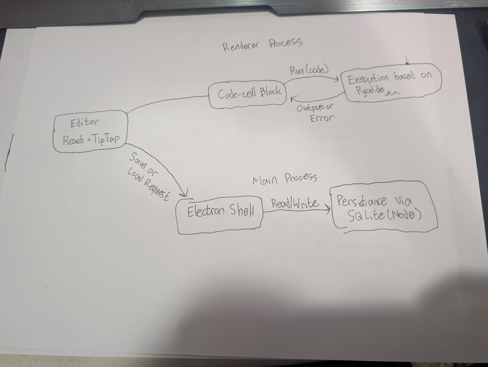

# Inline Code Creator — Design Document

| | |
|---|---|
| **Authors** | Greyson King |
| **Reviewers** |  Instructor |
| **Status** | In Review |
| **Last updated** | 2026-10-22 |
| **Links** | Proposal: https://docs.google.com/document/d/1iBrFLyfY3VYon1t1mtc_l0OpALcGCperPeTFTCAm9Mg/edit?tab=t.0 · 
Repo: https://github.com/kinggreyson/InlineCodeCreator · 
Issues Tracker: https://github.com/kinggreyson/InlineCodeCreator/issues |

## Revision history

*A design doc changes as the design does. Record each meaningful revision so a reader can tell what the doc said when a decision was made.*

| Date | Author | What changed |
|---|---|---|
| 10/20/26 | Greyson King | First draft |
| 10/22/26 | Greyson King | Final draft |

---

## 1. Context and scope

Inline Code Creator is a notes-first desktop app for students in introductory programming courses (BYU CS 110 / CS 111, which teach Python). A student writes formatted notes the way they would in Google Docs, and inserts a visually distinct, collapsible code cell wherever a concept needs a runnable example. The cell runs Python in place and shows its output beneath it, with no server or account.

The need comes from an interview with a student in an intro course and supporting external sources: code blends into prose in a general-purpose doc, and notes get buried when written inside a code file. The full argument and evidence are in the proposal (linked above). This design covers the single-user MVP only.

## 2. Goals and non-goals

**Goals** — each one can be checked in a demo:

- A new user can tell which parts of a note page are code and which are prose without being told (at least 4 of 5 testers, in a two-minute test).
- A user can add a code cell to a note and run it, with output on the same page, in under 30 seconds.
- A student can finish a study task (find an example and rerun it) without leaving the app or opening a second window.
- Editing prose never changes a code cell, and a saved note reopens with prose and code unaltered.
- A new user, given no instructions, can insert and run a code cell.

**Non-goals** — 
- Real-time multi-user collaboration. It needs a sync layer and server, and is not required to test the core hypothesis.
- Multi-language execution. The MVP runs Python only.
- A Google Docs add-on. It was considered and set aside (see §6).
- Any hosted backend, user accounts, or cloud storage. Everything runs and saves locally.
- Version history beyond basic save and load.

## 3. System-context diagram

The system is one desktop app. At runtime it has no external services: the Python engine is bundled with the installer, and notes are stored on the student's own disk. GitHub Releases only matters at install time.

## 4. Architecture and components

| Component | Responsibility | Talks to | Interface (rough) |
|---|---|---|---|
| Electron Shell | Owns the app window and the main process; routes save and load requests between the interface and storage | Editor, Persistence | IPC messages (save note, load note) |
| Editor | 	Rich-text writing surface (fonts, sizes, headings, lists, tables); holds the open document in memory and hosts code cells | Code-cell node, Electron shell | Document state in memory; IPC requests to save and load |
|Code-cell node|A custom block inside the editor: holds the code text, expanded or collapsed state, a user-entered subject line, and the output area| Execution engine | Message to run code and receive output or an error |
|Execution engine| Runs the student's Python locally and captures printed output and errors |Code-cell node|Message in with code, message out with output, error, or timeout|
|Persistence|Stores notes as structured blocks in a local SQLite file|Electron shell|Read and write requests from the main process|

### Core flow, traced end to end
The most important MVP action: write a note with a runnable example, then come back to it.

1. The student types notes in the Editor.
2. They insert a code cell. The Editor creates a code-cell node at the cursor, visually bordered and distinct from the prose.
3. They type Python into the cell. The cell grows as the code grows.
4. They click Run. The code-cell node sends the code to the Execution engine.
5. The Execution engine runs it locally and returns the printed output.
6. The code-cell node shows the output directly beneath the code.
7. On save, the Editor turns the document into prose blocks and code-cell blocks and sends it to the Electron shell, which has Persistence write it to the local file.
8. On reopen, Persistence returns the blocks and the Editor rebuilds the page with prose and code intact.

### The failure case

The same flow when the student's code never finishes (for example, an accidental infinite loop):

1. Steps 1–4 are as above.
2. The Execution engine does not return, and the Run button shows a running state.
3. After a time limit (The value is undecided, see §7), the Execution engine is stopped and restarted.
4. The cell shows a clear "stopped: took too long" message in the output area. The rest of the note stays editable and unchanged.
5. The student fixes the code and runs again.

Two other failures follow the same principle: nothing the student wrote is lost, and the failure shows up where they are already looking.

- Python error: the error text appears in the output area, styled as an error, and the notes are untouched.
- Save fails (for example, the disk is full or the file is locked): the editor keeps the document in memory, shows a visible unsaved warning, and lets the student retry. There is no background data loss.

## 5. Data model

| Entity | Key fields | Relationships | MVP or roadmap |
|---|---|---|---|
| Notes | id, title, created and updated times | Has many Blocks, in order | MVP |
| Block | id, position, type (prose or code), content | Belongs to one Note | MVP |
| Code-cell fields (on a code Block) | code text, collapsed flag, user-entered subject line|Part of a code Block | MVP |
| Last run output | output text, whether it was an error | Belongs to one code Block | MVP |
| Shared document | merged edits from multiple users | Belongs to one Note | Roadmap (Collaboration) |

Who owns what state: Persistence owns what is saved on disk. The Editor owns the document while a note is open. The code-cell node owns transient run state (running, finished, error), which is never saved. The last output is saved though.

## 6. Technology choices and alternatives considered
   
- **Decision:** Build a standalone desktop app instead of a Google Docs add-on
- **Chosen:** Electron app with a React and Tiptap editor.
- **Alternative considered:** A Google Docs add-on, which would have meant a familiar surface and no install.
- **Why the chosen option wins,** given our goals: The core requirement is a code cell that is visually distinct, collapsible, and runnable in place. Apps Script can insert and format text in a document, but custom interactive controls are limited to a sidebar or dialog, so the collapse control could not sit in the document beside the content it controls. A standalone editor gives full control over that block.
- **Evidence:** Spike on the add-on path. Tested creating a minor example in Google Docs, and ran into the limitations described above. Made the decision to strive for higher quality in a custom application.
- **What would change our mind:** Docs gaining embeddable interactive blocks, or interviews showing students will not leave Google Docs for a separate app.

    ### Decision 
- **Decision:** Run Python locally in the app with Pyodide instead of a server-side sandbox
- **Chosen:** Pyodide (Python compiled to WebAssembly), bundled in the app, so code runs on the student's own machine.
- **Alternative considered:** Sending code to a server-side sandbox (for example, containers or a hosted code-execution service).
- **Why the chosen option wins,** given our goals: It removes the riskiest infrastructure piece, safely running arbitrary student code on a server. It also keeps the app free of servers, accounts, and an internet dependency, which fits a one-semester solo MVP.
- **Evidence:** Early interview evidence is why we choice Python. Plans to test Pyodide rely on future testing install size and first-launch time, in Milestone 1.
What would change our mind: Pyodide cannot run representative course code, install size or startup time is unacceptable, or the target courses need another language.

## 7. Risks and open questions

| Risk or question | Why it matters | Owner | How we'll find out, and by when |
|---|---|---|---|
| Pyodide may not cover what a specific intro assignment needs | The core promise is runnable Python | Greyson King | Run real CS 110 / CS 111 assignment code in it, during Milestone 1 |
| Electron plus Pyodide may mean a large install and slow first launch | A student could leave before seeing the value | Greyson King | Measure install size and cold start, during Milestone 1 |
| The code cell (auto-grow, collapse, output) is hard front-end work | It is the main differentiator | Greyson King | Build and validate it in isolation, during Milestone 2 |
| Runaway code could freeze the app | An infinite loop is a normal beginner mistake | Greyson King | 	Run the engine off the UI thread with a time limit; test with a deliberate infinite loop, during Milestone 2 |
| Open: what is the run time limit? | Too short blocks legitimate code; too long feels frozen | Greyson King | Pick a starting value and test it in Milestone 2 |
| Open: autosave or explicit save? | Could mistakenly save something not intended to be saved or alternative could lose notes | Greyson King | Decide in Milestone 4 |

## 8. Implementation plan

The order follows what I see as the biggest risks:

| Milestone | What works when it's done | Depends on |
|---|---|---|
| 1 | The thinnest slice: an Electron window with one plain code cell that runs Python through Pyodide and shows output. Install size and startup time are measured. | — |
| 2 | The code cell as a real editor block: auto-grows, collapses with a subject line, shows output beneath it, and stops runaway code. Built and tested in isolation first. | 1 |
| 3 | Docs-style formatting around it (fonts, sizes, headings, lists, tables) using existing editor extensions | 2 |
| 4 | 	Save and reopen a note with prose and code intact, then package an installer and publish it on GitHub Releases | 3 |

---

## Sign-off

| Reviewer | Role | Date | Approved |
|---|---|---|---|
| Dr. Stephens | Instructor | [date] | ☐ |
